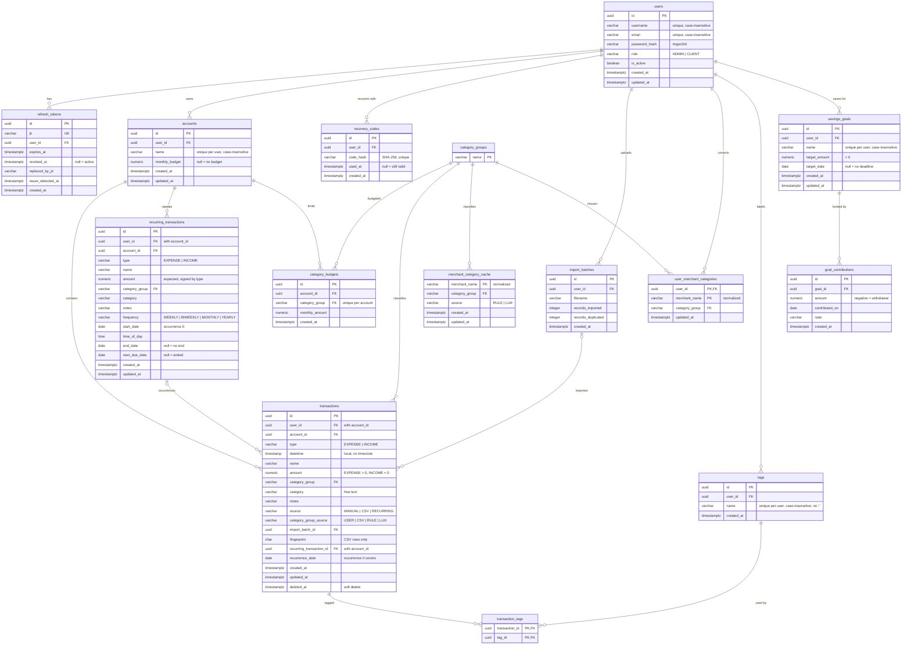

# Data Model

PostgreSQL schema of the Spring Boot backend (`backend/`), derived from the API contract in [openapi.yaml](openapi.yaml). The schema is created by Flyway migrations in `backend/src/main/resources/db/migration` and tested in `backend/src/test/java/com/financialcoach/db/MigrationsTest.java`.

## Diagram

## Conventions

| Topic | Decision | Why |
|---|---|---|
| Primary keys | `uuid`, generated by the app as UUIDv7; `uuidv7()` as DB default | Safe to expose in URLs; time-ordered, so B-tree indexes stay compact |
| Money | `numeric(14,2)` → `BigDecimal` | Exact decimal arithmetic; never floating point |
| Transaction time | `timestamp` (no timezone) | It is the local time on the receipt; converting to UTC could move it to another day or month |
| System timestamps | `timestamptz` | They are instants (when something happened in the system) |
| Small fixed sets | `varchar` + `CHECK` | Simple; readable values in SQL and logs |
| Category groups | Lookup table `category_groups` + FK; `category` is free text inside the group | One list referenced by two tables; adding a group is a single `INSERT` migration. V7 renamed `categories` and swapped the two columns |
| `updated_at` | Set by Hibernate (`@UpdateTimestamp`) | No database triggers to maintain |
| Schema ownership | Flyway only; Hibernate `ddl-auto: validate` | Every schema change is versioned and reviewable |
| Constraint names | `ck_*`, `fk_*`, `uq_*`, `ux_*`, `ix_*` | Errors name the rule that failed, so they can be mapped to API errors |

## Rules enforced by the database

These are business rules from the contract that PostgreSQL itself guarantees, even if application code has a bug:

| Rule | Constraint |
|---|---|
| Expenses are positive, income is negative, zero is invalid | `ck_transactions_amount_sign` |
| A transaction belongs to an account of the same user | `fk_transactions_account` (composite FK on `account_id, user_id`) |
| Account names are unique per user, ignoring case | `ux_accounts_user_name` |
| Category groups come from the allowed list | `fk_transactions_category_group`, `fk_merchant_category_cache_category_group` |
| A CSV row cannot be imported twice into the same account | `ux_transactions_account_fingerprint` |
| CSV rows always have a fingerprint, manual rows never do | `ck_transactions_fingerprint` |
| Budgets are not negative | `ck_accounts_monthly_budget`, `ck_category_budgets_amount` |
| One budget per category group and account | `ux_category_budgets_account_group` |
| Goal names are unique per user, ignoring case; targets are positive | `ux_savings_goals_user_name`, `ck_savings_goals_target_amount` |
| A contribution moves money (not zero) | `ck_goal_contributions_amount` |
| A recurring transaction belongs to an account of the same user | `fk_recurring_transactions_account` |
| An occurrence belongs to a rule of its own account | `fk_transactions_recurring_transaction` (composite FK on `recurring_transaction_id, account_id`) |
| A linked transaction always says which occurrence it covers | `ck_transactions_recurrence` |
| At most one active transaction per occurrence | `ux_transactions_recurrence` (partial: deleted rows excluded) |
| Email and username are unique, ignoring case | `ux_users_email`, `ux_users_username` |
| Tag names are unique per user, ignoring case, trimmed and without `;` | `ux_tags_user_name`, `ck_tags_name` |

## Notable decisions

- **Transactions are stored**, not re-read from CSV files on every request as in the Flask backend. CSV and form are just two ways to create rows.
- **Soft delete** (`deleted_at`): the main index is partial (`WHERE deleted_at IS NULL`), so deleted rows do not slow down listings. The fingerprint index deliberately **includes** deleted rows: re-uploading a file does not bring back transactions the user deleted.
- **`transactions.user_id` is redundant on purpose.** It makes ownership checks a single-table filter, and the composite FK guarantees it always matches the account owner.
- **`refresh_tokens.revoked_at` replaces `is_revoked`**: one source of truth instead of a flag and a timestamp that could disagree.
- **`users.id` is the public id** (JWT `sub`). The Flask schema had an integer `id` plus a separate `public_id`.
- **`source` and `category_group_source` are internal**: not exposed by the API, but they record which channel created a row (form, CSV, later WhatsApp) and who chose the category group (user, CSV, rules, LLM).
- **`import_batches`** keeps one row per upload, for auditing and a future "undo import".
- **`merchant_category_cache` is shared** by all users, so a merchant is sent to the LLM only once. Only LLM answers are written to it (with `INSERT ... ON CONFLICT DO NOTHING`, so two imports of the same new merchant do not collide).
- **Corrections are per user** (V13, `user_merchant_categories`): the group a user chooses or changes for a merchant applies to their next transactions of it, before the shared cache. Writing corrections to the shared cache would let one user change everyone's categorization.
- **Recurring transactions create their occurrences automatically** (V8). A daily job (and one run at startup) inserts each due occurrence as a transaction with `source = RECURRING`. `next_due_date` only moves forward, so an occurrence the user deleted is not created again. Due dates are always computed from `start_date` (January 31 → February 28 → March 31).
- **A real charge replaces the automatic one.** When a CSV row matches a rule (same account, type and merchant, within a few days of a due date), the generated transaction is soft-deleted and the CSV row takes its place, with the real amount. `ux_transactions_recurrence` excludes deleted rows so the two can coexist. This avoids counting a subscription twice and lets the alerts detect price changes.
- **Tags belong to a user** (V9): `tags` holds each user's labels and `transaction_tags` links them to transactions (many to many). Names are compared ignoring case, so "Work" and "work" are one tag, spelled as first created. The application checks that a transaction only gets tags of its own user. A tag that no active transaction uses stays in the table but is not listed by `GET /tags`; deleting a transaction or a user removes its links (`ON DELETE CASCADE`). New tags are inserted with `ON CONFLICT DO NOTHING`, so two requests creating the same tag at once both get it instead of one failing on the unique index. Recurring rules have no tags of their own: each new occurrence copies the tags of the latest occurrence, and a CSV charge that replaces a generated occurrence keeps its tags.
- **Category budgets are opt-in** (V10): `category_budgets` has a row only for the groups the user wants to watch, so the dashboard never shows 26 bars. Like `accounts.monthly_budget`, the amount applies to every month and the spending is computed from the transactions. They are independent of the account's budget: adding up to more than it is allowed (the frontend only warns). `PUT` replaces them all with a bulk delete followed by inserts, so the unique index never sees two rows of the same group.
- **Savings goals belong to the user, not to an account** (V11), because savings usually span accounts; the Goals view does not change with the selected account. Progress comes only from the **contributions the user records** (negative ones are withdrawals): the app does not know account balances, and guessing from income minus expenses would be wrong as soon as there are two goals. Nothing derived is stored: saved amount, pace, required monthly amount, projected date and status are computed on every request (`GoalProjection`, a pure class with its own unit tests). The rule that a goal never goes below zero lives in the service, since it depends on the sum of rows.
- **Recovery codes instead of email** (V12): sign-up returns 8 single-use codes and stores only their SHA-256. The codes have about 60 bits of entropy, so a slow hash like Argon2 is unnecessary, and checking one is a lookup on `ux_recovery_codes_hash`. Using a code is a single conditional `UPDATE ... WHERE used_at IS NULL`, so two requests with the same code cannot both succeed. Generating new codes deletes the old rows.
- **Alerts are not stored**: `GET /accounts/{id}/alerts` computes them on every request from the budgets and the recurring transactions.

## Not migrated

The Flask SQLite data is not migrated: it only contains demo users, and its CSV format is obsolete. The `dev` profile loads equivalent demo data from `backend/src/main/resources/db/dev/R__dev_seed.sql`.
