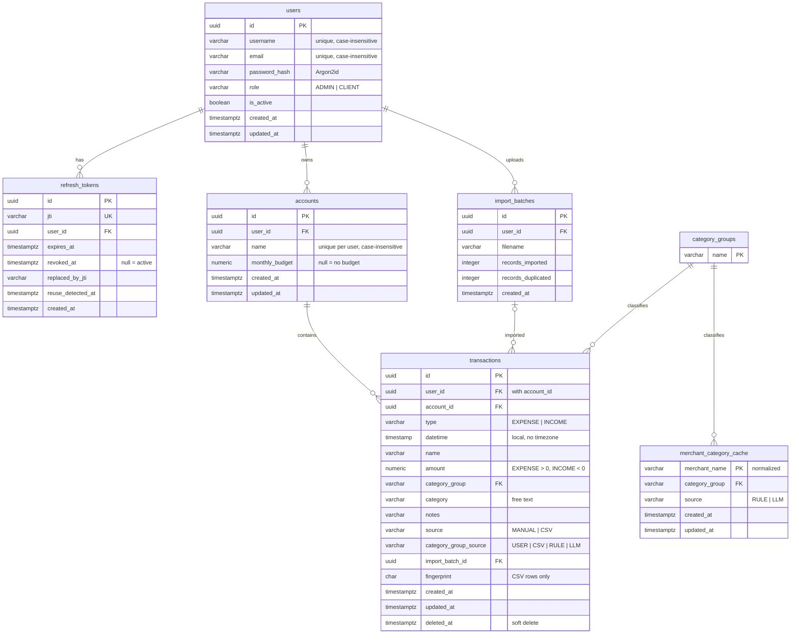

# Data Model

PostgreSQL schema of the Spring Boot backend (`backend/`), derived from the API contract in [openapi.yaml](openapi.yaml). The schema is created by Flyway migrations in `backend/src/main/resources/db/migration` and tested in `backend/src/test/java/com/financialcoach/db/MigrationsTest.java`.

## Diagram

## Conventions

| Topic | Decision | Why |
|---|---|---|
| Primary keys | `uuid`, generated by the app as UUIDv7; `uuidv7()` as DB default | Safe to expose in URLs; time-ordered, so B-tree indexes stay compact |
| Money | `numeric(14,2)` → `BigDecimal` | Exact decimal arithmetic; never floating point |
| Transaction time | `timestamp` (no timezone) | It is the local time on the receipt; converting to UTC could move it to another day or month |
| System timestamps | `timestamptz` | They are instants (when something happened in the system) |
| Small fixed sets | `varchar` + `CHECK` | Simple; readable values in SQL and logs |
| Category groups | Lookup table `category_groups` + FK; `category` is free text inside the group | One list referenced by two tables; adding a group is a single `INSERT` migration. V7 renamed `categories` and swapped the two columns |
| `updated_at` | Set by Hibernate (`@UpdateTimestamp`) | No database triggers to maintain |
| Schema ownership | Flyway only; Hibernate `ddl-auto: validate` | Every schema change is versioned and reviewable |
| Constraint names | `ck_*`, `fk_*`, `uq_*`, `ux_*`, `ix_*` | Errors name the rule that failed, so they can be mapped to API errors |

## Rules enforced by the database

These are business rules from the contract that PostgreSQL itself guarantees, even if application code has a bug:

| Rule | Constraint |
|---|---|
| Expenses are positive, income is negative, zero is invalid | `ck_transactions_amount_sign` |
| A transaction belongs to an account of the same user | `fk_transactions_account` (composite FK on `account_id, user_id`) |
| Account names are unique per user, ignoring case | `ux_accounts_user_name` |
| Category groups come from the allowed list | `fk_transactions_category_group`, `fk_merchant_category_cache_category_group` |
| A CSV row cannot be imported twice into the same account | `ux_transactions_account_fingerprint` |
| CSV rows always have a fingerprint, manual rows never do | `ck_transactions_fingerprint` |
| Budgets are not negative | `ck_accounts_monthly_budget` |
| Email and username are unique, ignoring case | `ux_users_email`, `ux_users_username` |

## Notable decisions

- **Transactions are stored**, not re-read from CSV files on every request as in the Flask backend. CSV and form are just two ways to create rows.
- **Soft delete** (`deleted_at`): the main index is partial (`WHERE deleted_at IS NULL`), so deleted rows do not slow down listings. The fingerprint index deliberately **includes** deleted rows: re-uploading a file does not bring back transactions the user deleted.
- **`transactions.user_id` is redundant on purpose.** It makes ownership checks a single-table filter, and the composite FK guarantees it always matches the account owner.
- **`refresh_tokens.revoked_at` replaces `is_revoked`**: one source of truth instead of a flag and a timestamp that could disagree.
- **`users.id` is the public id** (JWT `sub`). The Flask schema had an integer `id` plus a separate `public_id`.
- **`source` and `category_group_source` are internal**: not exposed by the API, but they record which channel created a row (form, CSV, later WhatsApp) and who chose the category group (user, CSV, rules, LLM).
- **`import_batches`** keeps one row per upload, for auditing and a future "undo import".
- **`merchant_category_cache` is shared** by all users, so a merchant is sent to the LLM only once.

## Not migrated

The Flask SQLite data is not migrated: it only contains demo users, and its CSV format is obsolete. The `dev` profile loads equivalent demo data from `backend/src/main/resources/db/dev/R__dev_seed.sql`.
